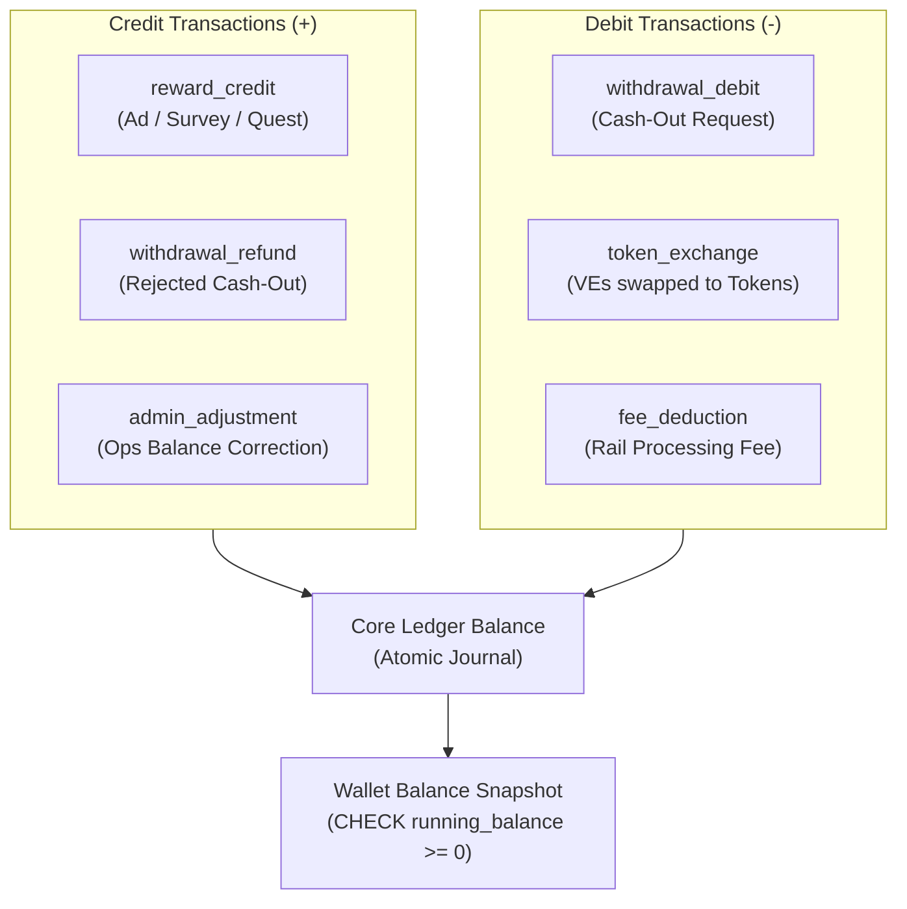
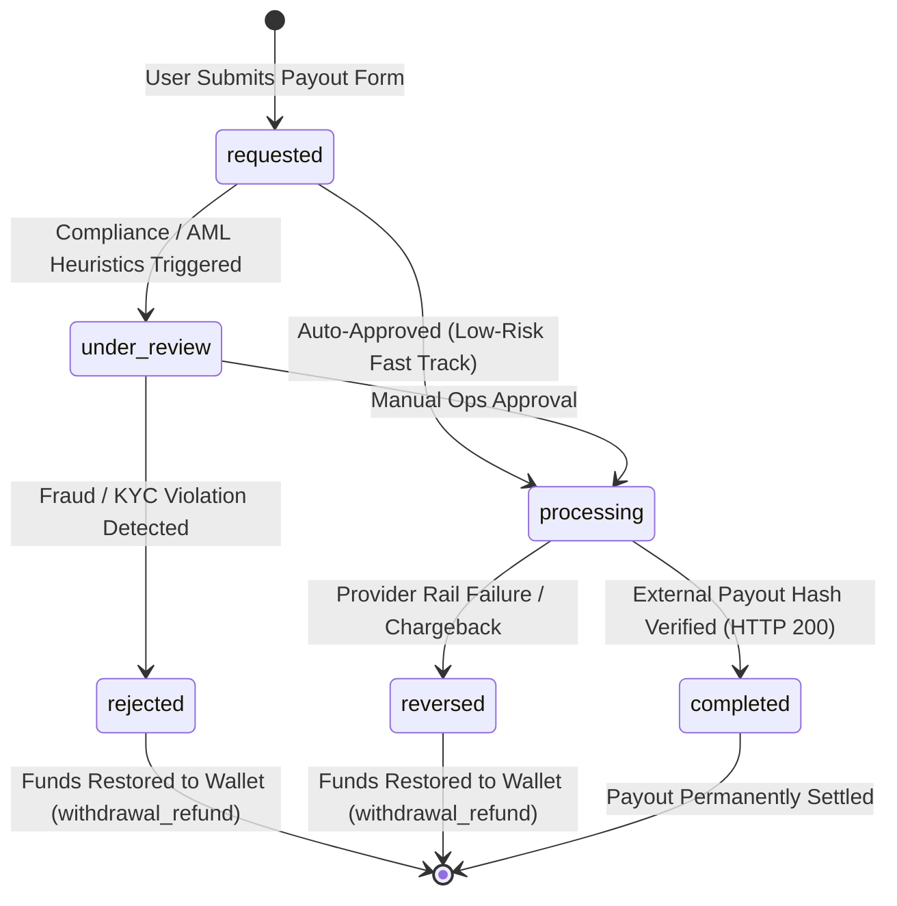

# 06 — WORK PACKAGE D: WALLET & WITHDRAWAL ANALYTICS SPECIFICATION

> **MANDATORY DATA AUTHENTICITY NOTICE**  
> *VELOOP is a real product under development, but the data supplied and evaluated for this assignment is fictional/simulated for analytical testing. In accordance with the Data Authenticity Policy, no metric or finding herein represents actual VELOOP production statistics, actual earnings, actual withdrawals, or live business performance.*

---

## 1. Executive Context & Financial Integrity Mandate
The wallet and withdrawal subsystem represents the ultimate financial interface between VELOOP and its users. The system must enforce **immutable, double-entry accounting integrity**, guaranteeing that no balance can be created without a verifiable earning source, and no cash-out can be disbursed without strict escrow reconciliation.

This specification details the **Wallet Transaction Model (D1)**, the **Multi-Stage Withdrawal Lifecycle (D2)**, and the **10 Core Withdrawal KPIs (D3)**.

---

## 2. Work Package D1: Wallet Transaction Model

The VELOOP wallet ledger records all economic movements across user balances. Every entry represents an atomic ledger movement.



### Transaction Schema Specification

| Field Name | Type | Allowed Values | Source System | Analytical Purpose | Status |
| :--- | :--- | :--- | :--- | :--- | :--- |
| `transaction_id` | String | `TXN_[0-9]{6}` | Core Ledger API | Primary Key; unique immutable journal entry | Confirmed |
| `user_id` | String | `USR_[0-9]{5}` | Auth Context | Owner of affected wallet balance | Confirmed |
| `timestamp` | Timestamp | Valid UTC ISO 8601 | Ledger Server Clock | Sequence ordering, velocity analysis | Confirmed |
| `transaction_type`| String | `reward_credit`, `withdrawal_debit`, `token_exchange`, `admin_adjustment`, `withdrawal_refund` | Ledger Core | Cash flow categorization and margin modeling | Confirmed |
| `amount` | Numeric | Signed Decimal (`+` credit, `-` debit) | Initiating Subsystem | Net balance delta calculation | Confirmed |
| `unit` | String | `VEs`, `Gems`, `Tokens` | Product Economy | Multi-currency segmentation | Confirmed |
| `status` | String | `completed`, `pending`, `reversed`, `failed` | Clearing Engine | Settlement and reconciliation tracking | Confirmed |
| `source` | String | `reward_engine`, `withdrawal_engine`, `exchange_service`, `manual_ops` | Subsystem Origin | Subsystem liability attribution | Confirmed |
| `reference_id` | String | Pointer to `reward_id`, `withdrawal_id`, or `exchange_id` | Foreign System | End-to-end operational auditability | Confirmed |
| `reversal_relationship_id`| String | `TXN_[0-9]{6}` or `NULL` | Ledger Core | Links offsetting entries to original transactions | Proposed |

---

## 3. Work Package D2: Multi-Stage Withdrawal Lifecycle

Cash redemptions must traverse a strict, auditable state machine to prevent race-condition overdrafts, block fraudulent cash drains, and isolate payment rail latency.



### Lifecycle Stage Attributes

| Field Name | Type | Format / Constraints | Analytical Significance |
| :--- | :--- | :--- | :--- |
| `withdrawal_id` | String | `WDR_[0-9]{4}` | Primary Key for payout tracking |
| `user_id` | String | `USR_[0-9]{5}` | Payout beneficiary identifier |
| `requested_amount` | Numeric | Decimal `>= 500` (min threshold) | Gross redemption demand volume |
| `currency_unit` | String | `VEs`, `Tokens` | Payout denomination |
| `withdrawal_method` | String | `PayPal`, `Crypto_USDT`, `GiftCard_Amazon`, `BankTransfer` | Payout rail channel distribution |
| `requested_timestamp`| Timestamp | Valid UTC ISO 8601 | Queue entry time; SLA clock start |
| `processing_timestamp`| Timestamp| Valid UTC ISO 8601 (`>= requested_timestamp`) | Internal review duration end; gateway dispatch |
| `final_timestamp` | Timestamp | Valid UTC ISO 8601 (`>= processing_timestamp`) | Terminal settlement or rejection time |
| `status` | String | `requested`, `processing`, `completed`, `rejected`, `reversed` | Payout pipeline health indicator |
| `rejection_reason_category`| String | `KYC_incomplete`, `minimum_threshold_not_met`, `suspected_fraud`, `third_party_provider_error`, `account_mismatch` | Payout failure root-cause analysis |
| `payout_reference_hash`| String | Hex hash string length `>= 8` | External cryptographic proof of settlement |
| `fee_amount` | Numeric | Decimal `>= 0` (e.g. 2% network fee) | Platform fee revenue calculation |

---

## 4. Work Package D3: The 10 Core Withdrawal KPIs

Each KPI adheres strictly to the required 11-point definition standard:

```
+---------------------------------------------------------------------------------------------------------+
|                                    10 WITHDRAWAL PERFORMANCE KPIS                                       |
+-----+----------------------------------+------------------+--------------------+------------------------+
| ID  | KPI Name                         | Frequency        | Target Stakeholder | Primary Value          |
+-----+----------------------------------+------------------+--------------------+------------------------+
| W01 | Withdrawal Request Volume        | Daily            | Payment Ops / CFO  | Payout pipeline demand |
| W02 | Completed Withdrawal Count       | Daily / Weekly   | VP Product / Ops   | Payout fulfillment     |
| W03 | Pending Withdrawal Queue Size    | Real-time / Daily| Operations Lead    | Backlog bottleneck     |
| W04 | Rejected Withdrawal Count        | Weekly           | Risk & Fraud Lead  | Fraud prevention       |
| W05 | Reversed Withdrawal Rate         | Monthly          | Finance / Treasury | Payout rail stability  |
| W06 | Average Processing Duration (SLA)| Daily / Weekly   | UX PM / Ops        | User trust & speed     |
| W07 | Completed Withdrawal Rate        | Weekly           | Executive Team     | Infrastructure quality |
| W08 | Pending Queue Dollar Value       | Daily Snapshot   | CFO / Treasury     | Cash liquidity reserve |
| W09 | Gross Payout Volume (Fiat Equiv) | Monthly          | CFO / Leadership   | Outflow liability      |
| W10 | Withdrawal Method Distribution   | Monthly          | Payment Ops        | Partner rail balancing |
+-----+----------------------------------+------------------+--------------------+------------------------+
```

### Detailed KPI Profiles

#### 1. Withdrawal Request Volume
- **Definition**: Total count of formal payout cash-out submissions made by users within the reporting window.
- **Formula**: `COUNT(withdrawal_id) WHERE requested_timestamp BETWEEN start_date AND end_date`
- **Data Required**: `withdrawal_id`, `requested_timestamp`
- **Data Source**: `Withdrawals`
- **Frequency**: Daily
- **Stakeholder**: Payment Operations / Finance
- **Business Purpose**: Monitors gross cash-out demand and spikes indicating potential marketing referral surges or fraud rings.
- **Interpretation**: Rapid surges require treasury liquidity rebalancing and increased review staffing.
- **Limitation**: Includes requests that will subsequently fail automated screening or KYC checks.
- **Status**: Proposed

#### 2. Completed Withdrawal Count
- **Definition**: Total count of withdrawal requests that successfully settle with payment rail confirmation.
- **Formula**: `COUNT(withdrawal_id) WHERE status = 'completed' AND final_timestamp BETWEEN start_date AND end_date`
- **Data Required**: `withdrawal_id`, `status`, `final_timestamp`
- **Data Source**: `Withdrawals`
- **Frequency**: Daily / Weekly
- **Stakeholder**: VP Product / Operations
- **Business Purpose**: Measures operational throughput and fulfilled user reward expectations.
- **Interpretation**: Consistent completion indicates smooth gateway integrations.
- **Limitation**: Does not convey monetary value or processing speed.
- **Status**: Proposed

#### 3. Pending Withdrawal Queue Size
- **Definition**: Total count of withdrawal requests currently awaiting manual review or payment gateway dispatch.
- **Formula**: `COUNT(withdrawal_id) WHERE status IN ('requested', 'processing')`
- **Data Required**: `withdrawal_id`, `status`
- **Data Source**: `Withdrawals`
- **Frequency**: Real-time / Daily
- **Stakeholder**: Operations Lead
- **Business Purpose**: Operational backlog monitoring to prevent customer support tickets and user anxiety.
- **Interpretation**: A rising queue points to operational review under-staffing or payment API rate limiting.
- **Limitation**: Does not indicate the age of individual pending tickets.
- **Status**: Proposed

#### 4. Rejected Withdrawal Count
- **Definition**: Number of withdrawal requests declined due to compliance, fraud, or rule violations.
- **Formula**: `COUNT(withdrawal_id) WHERE status = 'rejected'`
- **Data Required**: `withdrawal_id`, `status`, `rejection_reason_category`
- **Data Source**: `Withdrawals`
- **Frequency**: Weekly
- **Stakeholder**: Risk & Fraud Lead
- **Business Purpose**: Audits fraud detection effectiveness and user onboarding friction.
- **Interpretation**: High numbers suggest bot farm infiltration or confusing KYC instructions.
- **Limitation**: False positives harm legitimate user retention.
- **Status**: Proposed

#### 5. Reversed Withdrawal Rate
- **Definition**: Percentage of completed payouts that fail post-settlement and bounce back from external rails.
- **Formula**: `(COUNT(withdrawal_id WHERE status = 'reversed') / COUNT(withdrawal_id WHERE status IN ('completed', 'reversed'))) * 100`
- **Data Required**: `withdrawal_id`, `status`
- **Data Source**: `Withdrawals`
- **Frequency**: Monthly
- **Stakeholder**: Finance / Treasury
- **Business Purpose**: Measures payout rail technical reliability and banking partner bounce rates.
- **Interpretation**: A rate above 1% requires immediate technical investigation with payment providers.
- **Limitation**: Reversals from traditional banking rails may lag settlement by 5–10 business days.
- **Status**: Proposed

#### 6. Average Processing Duration (Turnaround Time SLA)
- **Definition**: Mean elapsed time in hours from user submission to terminal completion.
- **Formula**: `AVG(EXTRACT(EPOCH FROM (final_timestamp - requested_timestamp)) / 3600) WHERE status = 'completed'`
- **Data Required**: `requested_timestamp`, `final_timestamp`, `status`
- **Data Source**: `Withdrawals`
- **Frequency**: Daily / Weekly
- **Stakeholder**: UX PM / Operations
- **Business Purpose**: Primary customer satisfaction metric; benchmarks speed against competitor reward platforms.
- **Interpretation**: Shorter durations drive repeat task engagement and strong social word-of-mouth.
- **Limitation**: Averages blend instant automated gift card redemptions with slow wire transfers.
- **Status**: Proposed

#### 7. Completed Withdrawal Rate
- **Definition**: Percentage of total submitted withdrawal requests that achieve successful completion.
- **Formula**: `(COUNT(withdrawal_id WHERE status = 'completed') / COUNT(withdrawal_id)) * 100`
- **Data Required**: `withdrawal_id`, `status`
- **Data Source**: `Withdrawals`
- **Frequency**: Weekly
- **Stakeholder**: Executive Leadership
- **Business Purpose**: High-level platform health metric; indicates redemption success.
- **Interpretation**: Legitimate user cohorts should maintain >90% completion rates.
- **Limitation**: In heavily attacked cohorts, this metric legitimately declines due to fraud blocking.
- **Status**: Proposed

#### 8. Pending Queue Dollar Value
- **Definition**: Aggregate monetary points value held in the pending review and processing queue.
- **Formula**: `SUM(requested_amount) WHERE status IN ('requested', 'processing')`
- **Data Required**: `requested_amount`, `status`
- **Data Source**: `Withdrawals`
- **Frequency**: Daily Snapshot
- **Stakeholder**: CFO / Treasury
- **Business Purpose**: Working capital management; ensures bank accounts hold sufficient float.
- **Interpretation**: Prevents liquidity shortages during payout batch executions.
- **Limitation**: Value fluctuates rapidly during batch settlement runs.
- **Status**: Proposed

#### 9. Gross Payout Volume (Fiat Equivalent)
- **Definition**: Total value of points liquidated and disbursed to users across the reporting window.
- **Formula**: `SUM(requested_amount WHERE status = 'completed')`
- **Data Required**: `requested_amount`, `status`, `final_timestamp`
- **Data Source**: `Withdrawals`
- **Frequency**: Monthly
- **Stakeholder**: CFO / Finance Director
- **Business Purpose**: Core expense metric; monitors cash outflow against collected ad revenues.
- **Interpretation**: Must remain below net ad network receivables to guarantee commercial profitability.
- **Limitation**: Does not account for payment rail transaction fees.
- **Status**: Proposed

#### 10. Withdrawal Method Distribution
- **Definition**: Percentage breakdown of completed payout transactions across each disbursement rail.
- **Formula**: `(COUNT(withdrawal_id WHERE withdrawal_method = [METHOD] AND status = 'completed') / Total Completed) * 100`
- **Data Required**: `withdrawal_method`, `status`
- **Data Source**: `Withdrawals`
- **Frequency**: Monthly
- **Stakeholder**: Payment Operations
- **Business Purpose**: Informs contract negotiations with payment rails and guides treasury cash balancing.
- **Interpretation**: Highlights user preferences (e.g., crypto USDT adoption in emerging markets vs PayPal in US).
- **Limitation**: Heavily influenced by regional payment availability constraints.
- **Status**: Proposed

---
*Deliverable Document Reference: `docs/06_WALLET_WITHDRAWAL_ANALYTICS.md` | Related Spec: `deliverables_tables/11_KPI_CATALOGUE.csv`.*
